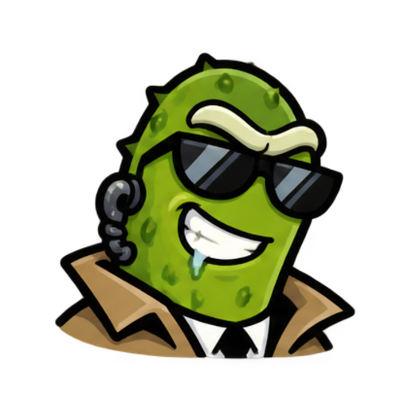

<p align="center">
  
</p>

<h1 align="center">Agent Cornichon</h1>

<p align="center">
  Your secret word is <strong><em>brouette</em></strong> (wheelbarrow).<br>
  Slip it into your next meeting to earn <strong>pickles</strong>.
</p>

<p align="center">
  <a href="#play-a-round">Play a round</a> ·
  <a href="#deploy-to-the-sandbox">Deploy to the sandbox</a> ·
  <a href="docs/pilot-rules.md">Pilot rules</a>
</p>

## Play a round

1. Open the **Cornichon** shortcut from Slack’s `/` menu and click **Ouvrir les
   inscriptions**. You can also use the pinned button if your channel has one.
2. Click **Rejoindre**, then **Démarrer la partie**. To play solo, start from
   your self-DM. Pickle HQ opens the DM with Agent Cornichon.
3. Read your secret word in your DM and work it into the conversation. Each
   agent gets a different word from the [150-word list](dictionary.ts).
4. After the meeting, click **Terminer l’opération** and report your result in
   your DM. Your first answer is final. Check your total under **Mon score**.

## Deploy to the sandbox

This command updates the app already installed in **`agent-cornichon-dev`**. You
need Node.js with `npx` and the Slack CLI. Use `slack login` to sign in and
`slack auth list` to check your account.

From the repository root, run `slack app list`. Find the `agent-cornichon-dev`
entry and copy its **App ID** and **Team ID**. Use the **Team ID** on that
entry. The **Workspace Grant** identifies a different target.

Replace `APP_ID` and `TEAM_ID` in the command below with those values. `npx`
makes Deno available to the Slack CLI during deployment.

```sh
npx --yes --package deno -c 'slack deploy --app APP_ID --team TEAM_ID --manifest-source local --hide-triggers'
```

When the CLI prints `Agent Cornichon deployed`, open the **Cornichon** shortcut
and start a new solo round to check that your word arrives in your DM.

<details>
<summary>First installation in another sandbox</summary>

With Deno and the Slack CLI available in your terminal, replace the placeholders
with your target IDs. The deployment output shows the app ID.

```sh
slack deploy --team "<id-sandbox>" --org-workspace-grant "<id-workspace>" --app deployed --hide-triggers
slack trigger create --team "<id-sandbox>" --org-workspace-grant "<id-workspace>" --app "<id-app>" --trigger-def triggers/cornichon.ts
```

Post the trigger link in the pilot channel and pin the message containing the
workflow button.

</details>

## Customize Pickle HQ

In Slack’s emoji picker, click **Add Emoji**. Upload the PNGs from the
[Agent Cornichon sticker pack](assets/emoji/) using the filenames without
`.png`.

The bot uses these seven custom emoji when available and standard Slack emoji
otherwise.

- `cornichon-agent` and `cornichon-lancement`
- `cornichon-mission` and `cornichon-rapport`
- `cornichon-reussite` and `cornichon-echec`
- `cornichon-score`

## Test and maintain the pilot

**Local tests.** Run the game and integration tests from the repository root.

```sh
deno test
```

**Two-player Slack test.** Join a round from two accounts and verify that each
account receives a different word, visible only in its DM. After the round,
report success on one account and failure on the other. For accounts with no
previous rounds, **Mon score** should show 30 and 0 respectively.

<details>
<summary>Test with the sandbox Datastore</summary>

The test uses the real Datastore and simulates Slack messages. It deletes its
test records when it finishes. Supply the test sandbox and app IDs.

```sh
CORNICHON_TEST_TEAM="<id-sandbox>" CORNICHON_TEST_APP="<id-app>" \
  deno test --allow-run=slack --allow-env=CORNICHON_TEST_TEAM,CORNICHON_TEST_APP integration.test.ts
```

</details>

<details>
<summary>Delete an agent’s game data</summary>

The pilot lead finds the agent’s Slack ID and first cancels any open operation
the agent organized. In the Datastore, delete their entries from `reports`,
remove their ID from `players`, and remove their entry from `words` in the
affected operations. Clear their ID wherever it appears as `organizer`. DMs and
channel messages follow the Slack workspace’s retention settings.

</details>

The pilot runs on Slack infrastructure. The app’s Datastore holds operations and
reports. [Pilot rules](docs/pilot-rules.md)
